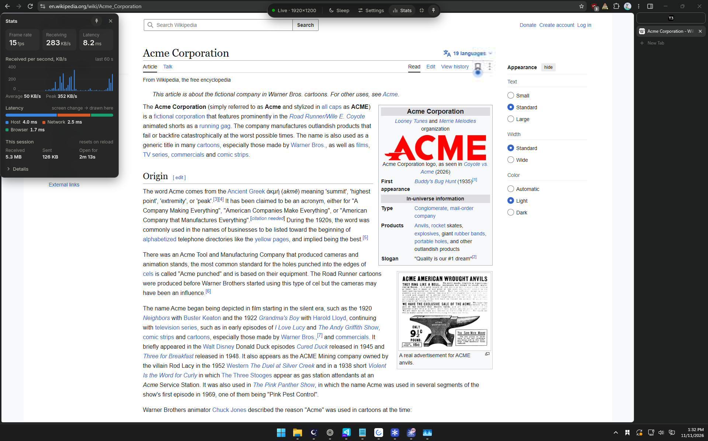

# peek

A remote desktop host for LAN and Tailscale that connects instantly. It is
meant for the times you want another PC's screen for a few seconds, where a
five-second connect is most of the wait.

The host stays running and idle. A browser tab is the client. Capture only
runs while a client tab is open and visible, so connecting costs one
WebSocket handshake and one frame.

Windows hosts only for now. The client is any modern desktop browser.



## Run

```
cargo build --release
target\release\peek.exe
```

It prints URLs ending in `#<token>`. Open the one with the host's LAN or
Tailscale address on another device. The browser remembers the token after
the first visit, so a bookmark is enough from then on.

| Flag | Meaning |
|---|---|
| `--bind <ip>` | Address to listen on (default: all interfaces) |
| `--port <n>` | Port (default 9182) |
| `--fps <n>` | Frame rate cap (default 60) |
| `--view-only` | Ignore mouse, keyboard and clipboard from clients |
| `--no-clipboard` | Do not synchronise the clipboard |
| `--detach` | Start in the background with no window, then return |
| `--log <file>` | Also append log lines to a file |
| `-v` | Log every input event and periodic throughput |

### In the client

Hover the dot at the top to show the toolbar; the pin keeps it open.

- **Sleep** stops the host sending the screen while keeping the connection
  open. Click the page or press Space to resume. Nothing is sent while
  asleep; after five seconds the host also releases the capture.
- **Settings** has three presets (Saver, Balanced, Crisp) and the individual
  settings, each applied as soon as it is picked:
  - **Quality**: JPEG quality while moving / once still: `lowest` 30 / 65,
    `low` 45 / 75, `medium` 70 / 90, `high` 85 / 95. Still regions are also
    re-sent with full colour resolution at medium and high.
  - **Resolution**: full, or half in each direction.
  - **Motion**: `soft` sends regions at half resolution while they change;
    they are re-sent at full resolution a quarter second after they stop.
  - **Frame rate**: at most 60, 30, 15 or 10 per second. Changes in between
    are combined, not dropped.
  - **Monitor**, when the host has more than one.
  - **Pause when unfocused**: sleep while the browser window is in the
    background and resume when it is focused again. Remembered per browser.
- **Stats** is one line (frame rate, receive rate, latency) until hovered;
  its pin keeps it open, and its title bar drags it anywhere. Open, it shows
  frame rate, receive rate and latency, a 60-second chart of
  data received (hover a bar for its value) with its average and peak,
  latency split into host (capture to send), network (half the round trip)
  and browser (receive to draw), and the data received and sent since the
  page was opened.

Full-screen frame sizes on a 1920x1200 desktop, from
`cargo test --release -- --ignored --nocapture frame_sizes`:

| Quality | Moving | Moving, soft | Sharp |
|---|---|---|---|
| lowest | 123 KB | 44 KB | 176 KB |
| low | 146 KB | 54 KB | 202 KB |
| med | 188 KB | 71 KB | 337 KB |
| high | 250 KB | 94 KB | 450 KB |

Half resolution divides each of these by about 2.7.

### Install: firewall rule and start at logon, as administrator

Two things need administrator rights once:

- Windows Firewall blocks a new program's inbound connections until it is
  allowed, so other devices cannot connect before this.
- Windows drops input injected into windows that run as administrator (Task
  Manager, installers) unless peek is elevated too.

From an elevated PowerShell:

```
.\scripts\install-autostart.ps1
```

This allows `peek.exe` through the firewall (private and Tailscale addresses
only) and registers a logon task that starts peek elevated and hidden.
`-Remove` undoes both.

## How it works

- **Capture**: DXGI Desktop Duplication. Windows delivers a frame only when
  the screen changed, so a still desktop costs nothing.
- **Diff**: the screen is cut into 64-pixel tiles and each frame is compared
  with the last. Changed tiles are merged into rectangles.
- **Encode**: each rectangle is sent as a JPEG, encoded in parallel. Regions
  go out at lower quality while changing and are re-sent sharply once still.
- **Backpressure**: the client acknowledges each frame after drawing it, and
  the host keeps at most two unacknowledged. A slow link gets fewer frames,
  not growing lag.
- **Input**: positions travel as fractions of the monitor and are injected
  with `SendInput`. Keys travel as physical key codes, so the host's keyboard
  layout decides what is typed.
- **Clipboard** (text only): the host pushes its clipboard to clients when it
  changes. In the other direction, pressing Ctrl+V in the client sends the
  local clipboard to the host before the paste.

## Security

- Every socket needs the access token, stored in `%APPDATA%\peek\token`.
- Connections from anything but private, link-local and Tailscale addresses
  are refused.
- Traffic is plain HTTP: encrypted by the tunnel over Tailscale, in the clear
  on a LAN.
- Anyone with the token has full control of the desktop. Treat it like a
  password.

## Limits

- The lock screen and UAC prompts cannot be seen or controlled.
- The Windows key, Alt+Tab and Ctrl+W are taken by the client's own browser
  and OS. The Fullscreen button captures them, but only on an HTTPS page.
- On a plain-HTTP page, text copied on the host reaches the local clipboard
  only right after a key press or click in the client, which a copy on the
  remote normally is.
- No audio, no file transfer, no phone keyboard.
- Full-screen motion (video, games) uses a lot of bandwidth. This is built
  for desktop work.

## Layout

```
src/main.rs               arguments, token, startup
src/server.rs             HTTP + WebSocket, authentication, input dispatch, clipboard watcher
src/engine.rs             capture loop, tile diff, JPEG encoding, per-client state
src/platform/mod.rs       the interface a backend provides
src/platform/windows/     Desktop Duplication, SendInput, clipboard, pointer shape
client/index.html         the whole client, embedded in the binary
```

`cargo test` runs the unit tests. `cargo test -- --ignored` adds the ones
that need a real desktop session.
